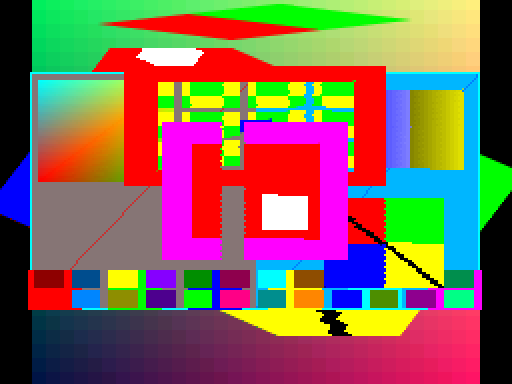
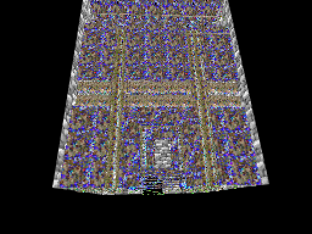
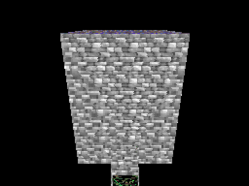
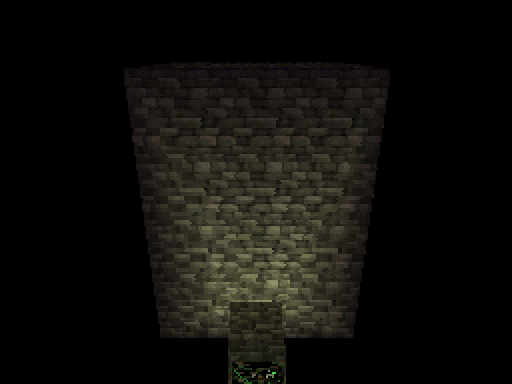
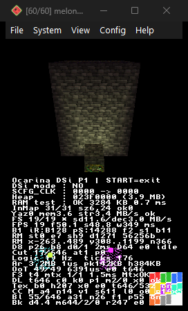
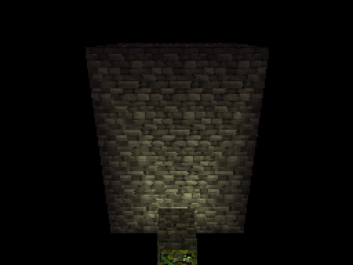

# Galeria

> Gerado de `docs/data/oot-dsi-progress.json`, campo `evidencias_publicadas`. As imagens são capturas reais do melonDS 1.1 em modo DS, não renderizações ilustrativas e não hardware físico.

São 6 capturas, e elas são tudo o que este repositório publica: cada uma mostra o painel 3D do DS (ou a janela completa) em um build e uma câmera declarados. Uma captura prova o que estava na tela naquele quadro, não que o jogo inteiro funciona. O conjunto de evidências de cada entrega fica no projeto de desenvolvimento, com hash em `evidencias/publicas/MANIFESTO.csv`.

## OTD-019 — `otd-019-cl1-top.png`

Cena sintética de teste do recorte no plano perto: polígonos coloridos atravessam a câmera.

| Campo | Valor |
|---|---|
| Cena | cena sintética de teste de recorte |
| Câmera | câmera de teste |
| Build | OTD-019 |
| Configuração | recorte no plano perto em espaço de olho |
| Leitura | Prova o comportamento do recorte, não o jogo. |

Detalhes da entrega em [resumo de OTD-019](resumos/OTD-019.md).

## OTD-023 — `otd-023-bm33-top.png`

Estado anterior à cadeia de mip: a sala texturizada aparece com pontilhado colorido de alta frequência.

| Campo | Valor |
|---|---|
| Cena | Bmori1_room_0, 646 triângulos |
| Câmera | ROOM_ANGLE 0 |
| Build | OTD-023, antes da cadeia de mip |
| Configuração | sem cadeia de mip |
| Leitura | Estado superado, mantido como evidência da hipótese de paleta refutada. |

Detalhes da entrega em [resumo de OTD-023](resumos/OTD-023.md).

## OTD-024 — `otd-024-mf0-top.png`

Estado anterior à cor de vértice: o painel ainda era pintado de branco pelo port.

| Campo | Valor |
|---|---|
| Cena | Bmori1_room_0, 646 triângulos |
| Câmera | ROOM_ANGLE 0 |
| Build | OTD-024, cadeia de mip no teto 2 |
| Configuração | GE_TEX_MIP_MAX 2, sem cor de vértice |
| Leitura | Estado superado, mantido para comparação com o painel colorido. |

Detalhes da entrega em [resumo de OTD-024](resumos/OTD-024.md).

## OTD-028 — `otd-028-f10e-top.png`

O mesmo painel depois de aplicar a cor de vértice no combiner: a pedra ganha o gradiente escuro da sala.

| Campo | Valor |
|---|---|
| Cena | Bmori1_room_0, 646 triângulos |
| Câmera | ROOM_ANGLE 0 |
| Build | OTD-028, GE_VTX_SHADE 1 |
| Configuração | GE_TEX_MIP_MAX 2, GE_TEX_LOD_BIAS 2048, GE_MIP_AREA32 1 |
| Leitura | Luminância média do painel caiu 71 %; o custo medido foi de 0,5 ms. |

Detalhes da entrega em [resumo de OTD-028](resumos/OTD-028.md).

## OTD-030 — `otd-030-f12a1.png`

Janela completa do melonDS: a sala na tela de cima e a telemetria na tela de baixo.

| Campo | Valor |
|---|---|
| Cena | Bmori1_room_0, 646 triângulos |
| Câmera | ROOM_ANGLE 0, ROOM_SPIN 0 |
| Build | OTD-030, GE_TEX_MIP_MAX 2 entregue |
| Configuração | GE_LERP 2, GE_VTX_SHADE 1, GE_MIP_EYE 0, GE_MIP_AREA32 1, GE_TEX_LOD_BIAS 2048 |
| Leitura | FPS 19, f 50,1 ms, s 48,8 ms, r 247. Captura de emulador, não de DSi físico. |

Detalhes da entrega em [resumo de OTD-030](resumos/OTD-030.md).

## OTD-030 — `otd-030-f12a1-top.png`

Recorte do painel 3D do mesmo build entregue, sem a telemetria da tela inferior.

| Campo | Valor |
|---|---|
| Cena | Bmori1_room_0, 646 triângulos |
| Câmera | ROOM_ANGLE 0, ROOM_SPIN 0 |
| Build | OTD-030, GE_TEX_MIP_MAX 2 entregue |
| Configuração | GE_LERP 2, GE_VTX_SHADE 1, GE_MIP_EYE 0, GE_MIP_AREA32 1, GE_TEX_LOD_BIAS 2048 |
| Leitura | Mesmo painel da janela completa; md5 fa1c5bc0a368ae6f5e8cb81858dae114. |

Detalhes da entrega em [resumo de OTD-030](resumos/OTD-030.md).
