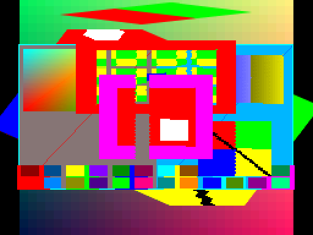

# OTD-019 — Recorte de polígono no plano perto

> Gerado de `docs/data/oot-dsi-progress.json` (esquema 1.0.0). Para alterar, edite `dados/progresso.json` do projeto, rode `ferramentas/gerar_recorte_publico.py` e depois este script; não edite este arquivo.

| Campo | Valor |
|---|---|
| Data | 2026-10-27 |
| Frente | motor gráfico |
| Fase | 2 |
| Estado | Testado em emulador |
| Build | árvore local sem identificador de versão |
| Commit | não disponível (árvore sem histórico git) |
| Validado em | melonDS 1.1, modo DS, 67 MHz |

## Resumo

O estágio equivalente ao RSP passou a cortar polígonos no plano perto em espaço de olho. Sem ele, um vértice muito atrás da câmera era preso pelo v16 e o motor cortava no plano errado.

## Estudo de engenharia

**Problema.** Um vértice 20.000 unidades atrás da câmera estourava o clamp de v16 e o motor cortava no plano errado; a crença inicial era de que o clipper do GE descartaria o triângulo inteiro.

**Como foi investigado.** Sonda com vtx[3].z = -2000 e a lista do jogo parada, medindo a borda esquerda do losango no painel.

**Decisão.** Aplicar a modelview em software e cortar por Sutherland–Hodgman em z = nearZ antes de enviar ao GE.

**Resultado.** O plano longe não descarta: corta. A borda que no limpo é 182,164,146,130,112,110,126,144,160,176,192,210,226 foi medida com 14 colunas de diferença antes da correção.

**Limitação.** O recorte contra x = ±w e y = ±w não é feito pelo port; fica com o clipper do GE.

## Medições

A condição de cada linha está declarada no arquivo. Salvo indicação contrária, o ambiente é melonDS 1.1, modo DS, 67 MHz — ou o computador, nas entregas testadas fora do emulador. Valor de emulador não é medição de hardware físico.

| Indicador | Valor | Condição | Método |
|---|---|---|---|
| Contagem de eventos | 14 colunas de painel | losango vermelho com vtx[3].z = -2000; câmera parada; build sem recorte no plano perto; painel de 256 colunas | leitura da borda esquerda no painel |

## Testes registrados

- **recorte no plano perto** — melonDS 1.1, modo DS, 67 MHz. Resultado: corte Sutherland–Hodgman em z = nearZ reproduz o N64

## Evidências

- 

  [`assets/otd-019-cl1-top.png`](../../assets/otd-019-cl1-top.png) — captura desta entrega, com hash em [`evidencias/publicas/MANIFESTO.csv`](../../../evidencias/publicas/MANIFESTO.csv).
- A pasta `evidencias/OTD-019` fica no projeto de desenvolvimento; o conjunto completo não é distribuído por este repositório.

## Onde ler o estudo completo

- Histórico técnico do projeto: `HISTORICO_MOTOR_GRAFICO.md`, seção "Fase 2 — O recorte de polígono entrou, e a lei do geometry engine que o justificava estava errada (2026-10-27)".
