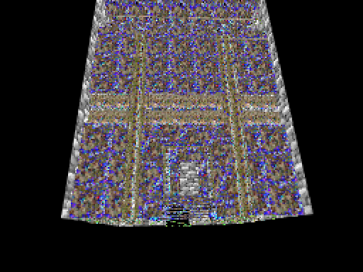

# OTD-023 — Sala texturizada: o confete era minificação, não paleta

> Gerado de `docs/data/oot-dsi-progress.json` (esquema 1.0.0). Para alterar, edite `dados/progresso.json` do projeto, rode `ferramentas/gerar_recorte_publico.py` e depois este script; não edite este arquivo.

| Campo | Valor |
|---|---|
| Data | 2026-10-27 |
| Frente | motor gráfico + jogo |
| Fase | 6 |
| Estado | Testado em emulador |
| Build | árvore local sem identificador de versão |
| Commit | não disponível (árvore sem histórico git) |
| Validado em | melonDS 1.1, modo DS, 67 MHz |

## Resumo

A primeira sala com textura chegou coberta de confete colorido. A hipótese herdada era paleta errada; a medição provou que a paleta estava certa e que o problema era minificação: o DS amostra um texel por pixel, sem filtro.

## Estudo de engenharia

**Problema.** Bmori1_room_0 saía com pontilhado cor-de-rainbow e a hipótese em vigor era de paleta CI errada.

**Como foi investigado.** Medição dos dois lados: texéis enviados e painel renderizado; contagem de texéis azul-dominantes; troca de cada textura por cor chata como controle.

**Decisão.** Descartar a hipótese de paleta e atacar a amostragem: nasce o instrumento de grão do painel e a meta explícita de minificação.

**Resultado.** Os texéis enviados medem r13 g12 b12 e grão 2,4, contra 17,25 no painel; zero de 45.952 texéis é azul-dominante. Trocar cada textura por uma cor chata derruba o painel a 0,68. A sala roda com 646 triângulos, 75 G_SETTIMG, 8 G_LOADTLUT em 2 paletas: Tex b0 h65 x0 e0 t646/532 on.

**Limitação.** O GE não tem filtro de minificação; mitigar exige cadeia de mip própria, que ainda não existe nesta entrega.

## Medições

A condição de cada linha está declarada no arquivo. Salvo indicação contrária, o ambiente é melonDS 1.1, modo DS, 67 MHz — ou o computador, nas entregas testadas fora do emulador. Valor de emulador não é medição de hardware físico.

| Indicador | Valor | Condição | Método |
|---|---|---|---|
| Grão do painel (métrica própria) | 17,25 grão do painel | Bmori1_room_0; câmera fixa (antes da régua de ângulo); build sala texturizada; sem cadeia de mip. Os texéis enviados medem 2,4; trocar texturas por cor chata leva o painel a 0,68. | speck2.py sobre recorte do painel |
| Contagem de eventos | 646 triângulos | Bmori1_room_0; câmera fixa; build sala texturizada; modo DS. 75 G_SETTIMG, 8 G_LOADTLUT em 2 paletas; Tex b0 h65 x0 e0 t646/532 on. | linha DL do HUD |

## Testes registrados

- **sala texturizada** — melonDS 1.1, modo DS, 67 MHz. Resultado: parede, madeira e painel reconhecíveis; hipótese de paleta refutada

## Problemas e correções

- **Corrigido** (OTD-023-P1): Hipótese de paleta CI errada refutada por medição; a causa era minificação sem filtro no GE.

## Conclusões anteriores corrigidas

- **Afirmação anterior:** O pontilhado colorido da sala texturizada vinha de paleta CI errada.
  **Evidência nova:** Os texéis enviados têm grão 2,4 e nenhum dos 45.952 texéis é azul-dominante; trocar cada textura por cor chata leva o painel a 0,68.
  **Conclusão vigente:** A paleta está correta; o defeito é minificação, porque o geometry engine amostra um texel por pixel sem filtro.
  **Registrada em:** OTD-023.

## Evidências

- 

  [`assets/otd-023-bm33-top.png`](../../assets/otd-023-bm33-top.png) — captura desta entrega, com hash em [`evidencias/publicas/MANIFESTO.csv`](../../../evidencias/publicas/MANIFESTO.csv).
- A pasta `evidencias/OTD-023` fica no projeto de desenvolvimento; o conjunto completo não é distribuído por este repositório.

## Onde ler o estudo completo

- Histórico técnico do projeto: `HISTORICO_MOTOR_GRAFICO.md`, seção "Fase 6 — O pontilhado da sala texturizada não era cor, era minificação (2026-10-27)".
- Histórico técnico do projeto: `HISTORICO_JOGO.md`, seção "Fase 6 — A sala texturizada entrou, e a consola ganhou o instrumento que matou a hipótese da paleta (2026-10-27)".
