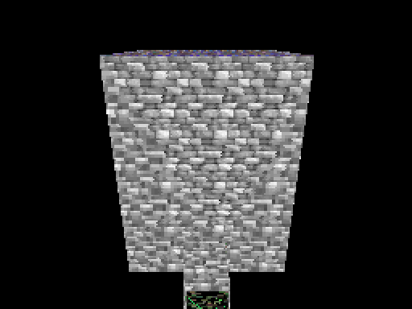

# OTD-025 — Correção de escala da sonda de mip (fator 4096)

> Gerado de `docs/data/oot-dsi-progress.json` (esquema 1.0.0). Para alterar, edite `dados/progresso.json` do projeto, rode `ferramentas/gerar_recorte_publico.py` e depois este script; não edite este arquivo.

**Correção dentro da entrega OTD-024.** Não conta como avanço independente.

| Campo | Valor |
|---|---|
| Data | 2026-10-27 |
| Frente | motor gráfico |
| Fase | 7b |
| Estado | Testado em emulador |
| Build | árvore local sem identificador de versão |
| Commit | não disponível (árvore sem histórico git) |
| Validado em | melonDS 1.1, modo DS, 67 MHz |

## Resumo

Uma correção dentro da entrega do mip: a posição projetada estava 4096 vezes maior do que deveria, o que fazia 467 de 646 faces caírem por uma guarda e produzia o falso veredito de que nada minificava. Corrigido, o histograma de níveis apareceu inteiro.

## Estudo de engenharia

**Problema.** O resultado da sonda dizia Lo 646/0/0/0, isto é, nenhuma face minificando, e esse número foi usado para refutar a fase 6.

**Como foi investigado.** Varredura de ROOM_ANGLE com a sonda ligada, que encontrou no primeiro ângulo a própria medição quebrada: cantos achatados no clamp e 467 faces caindo pela guarda pxA == 0.

**Decisão.** Corrigir o deslocamento da projeção de 16 para 28 e remedir no mesmo ângulo preso.

**Resultado.** Com ROOM_ANGLE 0: Lo 2/25/256/363 e gp0, sem guarda e sem área perdida; pior face r100824, R ≈ 79. O veredito da fase 6 foi restaurado.

**Limitação.** Esta é uma correção dentro de OTD-024 e não conta como avanço independente; compartilha as capturas e não substitui a necessidade de varredura de ângulo.

## Medições

A condição de cada linha está declarada no arquivo. Salvo indicação contrária, o ambiente é melonDS 1.1, modo DS, 67 MHz — ou o computador, nas entregas testadas fora do emulador. Valor de emulador não é medição de hardware físico.

| Indicador | Valor | Condição | Método |
|---|---|---|---|
| Contagem de eventos | 467 faces de 646 perdidas pela guarda pxA == 0 | Bmori1_room_0; câmera ROOM_ANGLE 0; build sonda com deslocamento 16 (errado); GE_TEX_MIP_MAX 2. Depois da correção: gp0 e histograma Lo 2/25/256/363. | linha Lo do HUD |

## Testes registrados

- **correção de escala** — melonDS 1.1, modo DS, 67 MHz. Resultado: histograma Lo 2/25/256/363 restaurado

## Problemas e correções

- **Corrigido** (OTD-025-P1): Deslocamento da projeção em 16 onde a derivação pede 28; corrigido.

## Conclusões anteriores corrigidas

- **Afirmação anterior:** Nenhuma face da sala minifica neste ângulo (Lo 646/0/0/0).
  **Evidência nova:** A posição projetada estava 4096× grande demais; 467 faces caíam pela guarda pxA == 0. Com o deslocamento 28, o histograma é Lo 2/25/256/363.
  **Conclusão vigente:** A sala minifica muito e a cadeia de mip é necessária; a fase 6 estava certa.
  **Registrada em:** OTD-025.

## Evidências

- 

  [`assets/otd-024-mf0-top.png`](../../assets/otd-024-mf0-top.png) — captura desta entrega, com hash em [`evidencias/publicas/MANIFESTO.csv`](../../../evidencias/publicas/MANIFESTO.csv).
- A pasta `evidencias/OTD-024` fica no projeto de desenvolvimento; o conjunto completo não é distribuído por este repositório.

## Onde ler o estudo completo

- Histórico técnico do projeto: `HISTORICO_MOTOR_GRAFICO.md`, seção "Fase 7 — a cadeia de mip existe, e ela primeiro produziu um número saturado que derrubou a fase 6 por engano (2026-10-27)".
- Histórico técnico do projeto: `HISTORICO_JOGO.md`, seção "Fase 7 — a régua de medida foi consertada, e ela refutou a fase 6 por engano antes de se refutar a si mesma (2026-10-27)".
